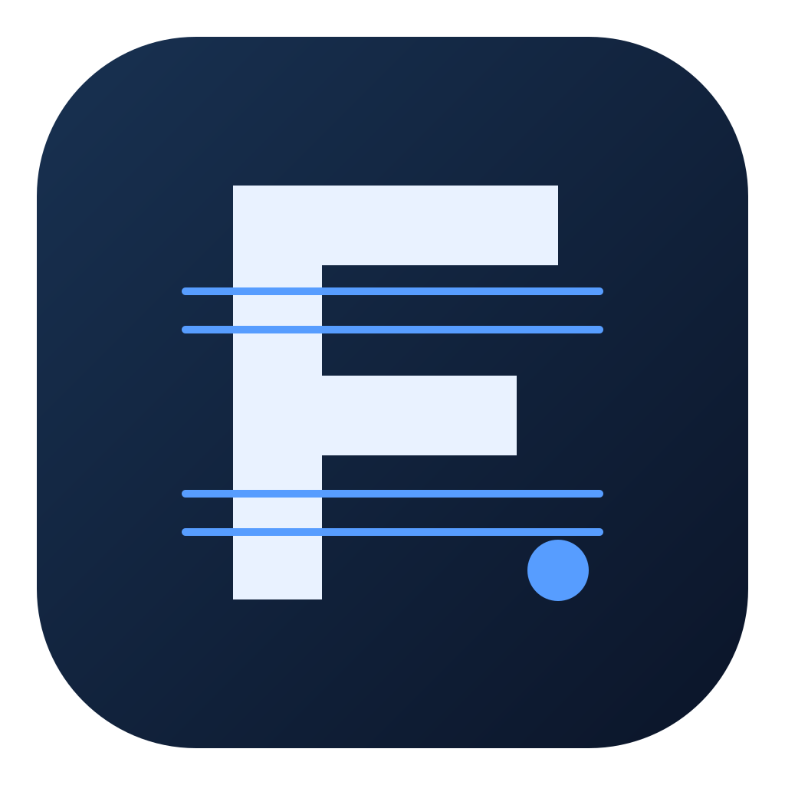
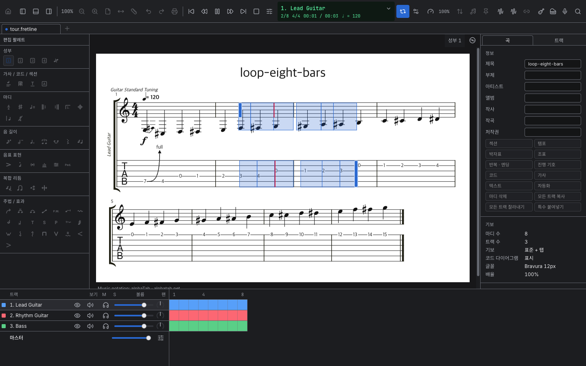

<div align="center">
  
  <h1>Fretline</h1>
  <h3>기타 연주자를 위한 오프라인 탭 악보 편집기 겸 연습실.</h3>
</div>

<div align="center">
  <a href="https://github.com/amsminn/fretline/releases/latest"></a>
  <a href="LICENSE"></a>
  
</div>

<div align="center">
  <a href="README.md">English</a> · <b>한국어</b>
</div>

<br>

Fretline은 기타 탭 악보를 위한 무료 오픈소스 macOS 앱입니다. 가지고 있는 탭 파일을 열어 키보드로 고치고, 연습할 구간을 드래그해서 그 구간만 반복 재생합니다. 계정, 구독, 네트워크 연결이 필요 없습니다.

<div align="center">
  
</div>

## 빠른 시작

```sh
curl -fsSL https://raw.githubusercontent.com/amsminn/fretline/main/install.sh | bash
```

Fretline을 열고 `⌘O`로 탭 파일을 엽니다. 연습할 마디를 드래그한 다음 `F9`로 반복을 켜고 `Space`로 재생합니다.

설치 스크립트는 최신 릴리스를 내려받아 SHA-256 체크섬을 확인하고 `Fretline.app`을 `/Applications`에 복사합니다. 쓰기 권한이 없으면 `~/Applications`에 설치합니다. 다시 실행하면 최신 버전으로 업데이트됩니다. 다른 위치에 설치하려면 `FRETLINE_INSTALL_DIR`을 지정하세요.

> [!NOTE]
> Fretline은 Apple Silicon Mac에서만 실행됩니다. 앱은 Apple 서명을 받지 않았습니다. 위 설치 스크립트는 이 문제를 처리하지만, [Releases](https://github.com/amsminn/fretline/releases)에서 브라우저로 DMG를 받았다면 설치한 뒤 `xattr -dr com.apple.quarantine /Applications/Fretline.app`를 실행해야 열립니다.

## 왜 Fretline인가요?

- **가지고 있는 파일을 그대로 엽니다** — GP 형식 파일(`.gp`, `.gpx`, `.gp5`, `.gp4`, `.gp3`), MusicXML, MIDI를 열고, 무엇을 읽었고 무엇을 읽지 못했는지 보고서로 보여 줍니다.
- **드래그한 구간만 반복** — 마우스로 범위를 고르면 그 범위만 반복됩니다. 재생 중에도 속도와 범위를 바꿀 수 있습니다.
- **키보드 중심 편집** — 프렛, 음 길이, 주법, 성부, 마디, 튜닝과 카포를 편집하고, 실행 취소와 다시 실행을 지원합니다. `⌘E`로 명령 팔레트를 엽니다.
- **함께 연주** — 볼륨·팬·뮤트·솔로가 있는 멀티트랙 믹서, 카운트인이 있는 메트로놈, 악보와 함께 재생되는 반주 오디오를 제공합니다.
- **어디로든 내보내기** — PDF, PNG, SVG, WAV(트랙별 파일 포함), MusicXML, MIDI, alphaTex, `.gp`로 내보냅니다.
- **작업을 잃지 않습니다** — 원본 파일을 덮어쓰지 않고, 앱이 비정상 종료되면 다음 실행 때 작업을 복구합니다.
- **완전한 오프라인** — 음색, 글꼴, 도움말이 앱에 들어 있습니다. 어디로도 데이터를 보내지 않습니다.
- **한국어와 영어** — 어두운 테마와 밝은 테마를 지원합니다.

## 파일 형식

| | 형식 |
| --- | --- |
| 열기 | `.gp` `.gpx` `.gp5` `.gp4` `.gp3` `.musicxml` `.mxl` `.mid` `.fretline` |
| 저장 | `.fretline` |
| 내보내기 | `.gp`(형식 8.1.3) · MusicXML · MIDI · alphaTex · PDF · PNG · SVG · WAV |

다른 형식으로 내보낼 때는 그 형식이 표현할 수 있는 범위만 담기며, 파일을 쓰기 전에 빠지는 항목을 보여 줍니다. 자세한 내용은 [docs/compatibility.md](docs/compatibility.md)에 있습니다.

## 문서

- [사용 설명서](docs/user-guide.md) — 열기, 편집, 연습, 내보내기
- [단축키](docs/shortcuts.md) — 모든 명령과 키
- [호환성](docs/compatibility.md) — 형식별 지원 범위
- [디자인 기반](docs/design-foundation.md) — 색, 글꼴, 간격 토큰
- [QA](docs/qa.md) — 자동 종단 간 검사를 실행하는 방법

## 소스에서 빌드

[Bun](https://bun.sh)이 필요합니다.

```sh
bun install
bun run build         # 앱 번들 빌드 (Electron을 띄우는 테스트보다 먼저)
bun run test          # 테스트
bunx electron .       # 개발 실행
bun run package:mac   # dist/mac-arm64/Fretline.app과 DMG를 만듭니다
```

## 사용한 기술

- [Electron](https://www.electronjs.org), [React](https://react.dev), [Tailwind CSS](https://tailwindcss.com)
- [alphaTab](https://alphatab.net): 파일 읽기, 악보 그리기, 소리 합성
- [Signalsmith Stretch](https://signalsmith-audio.co.uk/code/stretch/): 음높이를 유지한 채 반주 속도 변경
- [Bravura](https://github.com/steinbergmedia/bravura): 음악 기호 글꼴

## 라이선스

Fretline 코드는 [MIT 라이선스](LICENSE)입니다. 함께 배포되는 외부 구성요소는 각자의 라이선스를 따르며 [NOTICE](NOTICE)와 `build/notices/`에 정리되어 있습니다. `tests/fixtures/gp/`의 테스트 파일은 alphaTab 테스트 데이터(MPL-2.0)이고, `tests/fixtures/musicxml/schema/`는 W3C MusicXML 4.0 스키마입니다. 출처는 `tests/fixtures/manifest.json`에 있습니다.

Fretline은 독립 프로젝트이며, 다른 악보 프로그램 제작사와 관계가 없습니다.
