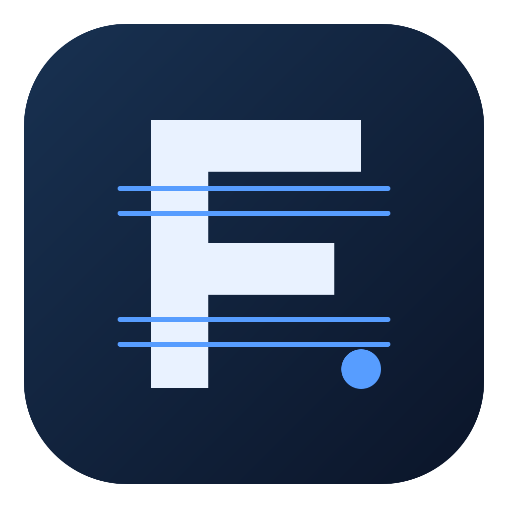
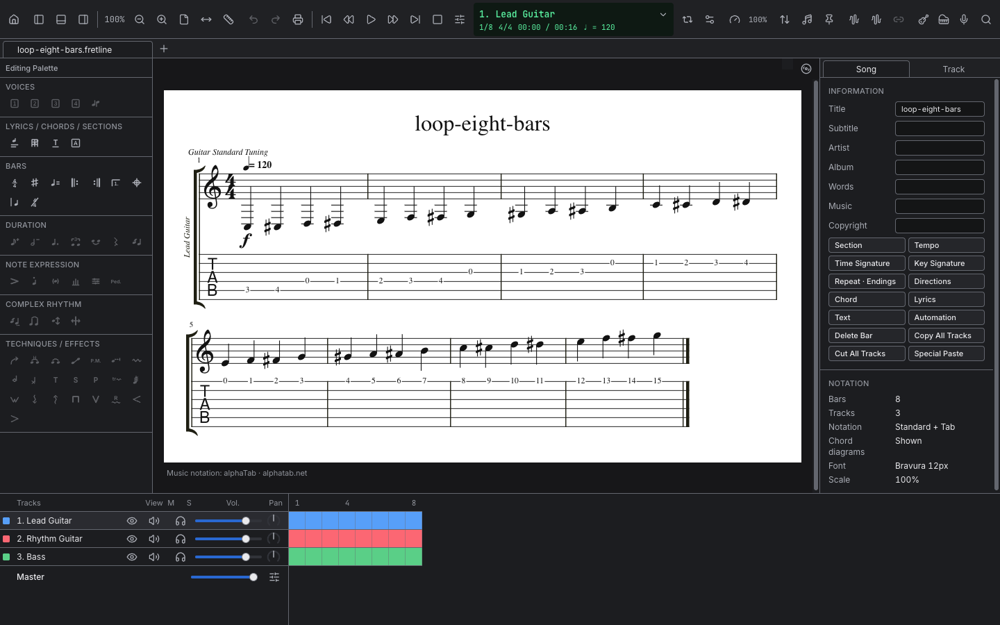

<div align="center">
  
  <h1>Fretline</h1>
  <h3>The offline tab editor and practice room for guitarists.</h3>
</div>

<div align="center">
  <a href="https://github.com/amsminn/fretline/releases/latest"></a>
  <a href="LICENSE"></a>
  
</div>

<div align="center">
  <b>English</b> · <a href="README.ko.md">한국어</a>
</div>

<br>

Fretline is a free, open-source macOS app for guitar tablature. Open the tab files you already have, edit them from the keyboard, then drag across any passage and loop it until you can play it. No account, no subscription, no network connection.

<div align="center">
  <picture>
    <source media="(prefers-color-scheme: dark)" srcset="docs/assets/screenshot-dark.png">
    <source media="(prefers-color-scheme: light)" srcset="docs/assets/screenshot-light.png">
    
  </picture>
</div>

## Quickstart

```sh
curl -fsSL https://raw.githubusercontent.com/amsminn/fretline/main/install.sh | bash
```

Open Fretline, press `⌘O` to open a tab, drag across the bars you want to practice, then press `F9` to loop and `Space` to play.

The installer downloads the latest release, verifies its SHA-256 checksum and copies `Fretline.app` into `/Applications` (or `~/Applications` when that is not writable). Run it again to update. Set `FRETLINE_INSTALL_DIR` to install somewhere else.

> [!NOTE]
> Fretline runs on Apple Silicon Macs only. The app is not signed by Apple: the installer above handles that, but if you download the DMG from [Releases](https://github.com/amsminn/fretline/releases) in a browser, run `xattr -dr com.apple.quarantine /Applications/Fretline.app` after installing.

## Why Fretline?

- **Opens what you already have** — GP-format files (`.gp`, `.gpx`, `.gp5`, `.gp4`, `.gp3`), MusicXML and MIDI, each with a report of what was and was not read.
- **Drag to loop** — Select a range with the mouse and only that range repeats. Change the speed or the range while it plays.
- **Keyboard-first editing** — Frets, durations, techniques, voices, bars, tuning and capo, with full undo and redo and a command palette on `⌘E`.
- **Play along** — A multitrack mixer with volume, pan, mute and solo, a metronome with count-in, and an audio backing track mixed with the score.
- **Export anywhere** — PDF, PNG, SVG, WAV (also one file per track), MusicXML, MIDI, alphaTex and `.gp`.
- **Your work is safe** — Originals are never overwritten, and after a crash Fretline restores what you were working on.
- **Fully offline** — Sounds, fonts and help are bundled. Nothing is sent anywhere.
- **Korean and English** — With dark and light themes.

## File formats

| | Formats |
| --- | --- |
| Open | `.gp` `.gpx` `.gp5` `.gp4` `.gp3` `.musicxml` `.mxl` `.mid` `.fretline` |
| Save | `.fretline` |
| Export | `.gp` (format 8.1.3) · MusicXML · MIDI · alphaTex · PDF · PNG · SVG · WAV |

Exports to other formats keep what each format can express, and Fretline lists what will be lost before it writes the file. [docs/compatibility.md](docs/compatibility.md) has the details.

## Documentation

- [User guide](docs/user-guide.md) — opening, editing, practicing and exporting
- [Keyboard shortcuts](docs/shortcuts.md) — every command and its key
- [Compatibility](docs/compatibility.md) — what is supported, per format
- [Design foundation](docs/design-foundation.md) — color, type and spacing tokens
- [QA](docs/qa.md) — how the automated end-to-end checks run

## Build from source

You need [Bun](https://bun.sh).

```sh
bun install
bun run build         # build the app bundle (required before tests that launch Electron)
bun run test          # run the test suite
bunx electron .       # run the app in development
bun run package:mac   # create dist/mac-arm64/Fretline.app and a DMG
```

## Built with

- [Electron](https://www.electronjs.org), [React](https://react.dev) and [Tailwind CSS](https://tailwindcss.com)
- [alphaTab](https://alphatab.net) for file parsing, engraving and synthesis
- [Signalsmith Stretch](https://signalsmith-audio.co.uk/code/stretch/) for changing backing-track speed without changing pitch
- [Bravura](https://github.com/steinbergmedia/bravura) for music symbols

## License

Fretline is released under the [MIT license](LICENSE). Bundled third-party components keep their own licenses, listed in [NOTICE](NOTICE) and `build/notices/`. Test files under `tests/fixtures/gp/` come from the alphaTab test data (MPL-2.0) and `tests/fixtures/musicxml/schema/` is the W3C MusicXML 4.0 schema; `tests/fixtures/manifest.json` records each source.

Fretline is an independent project and is not affiliated with any other notation software vendor.
